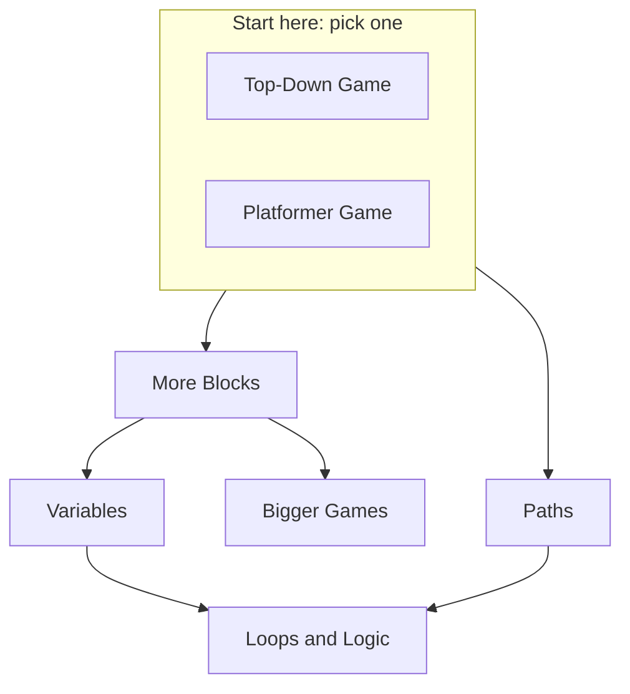

# Sprite Paths

A block-based game maker for grid-based platformers and top-down games. It is built on the latest
[Blockly](https://github.com/RaspberryPiFoundation/blockly) and [p5.js](https://p5js.org/), with a small
grid-aware sprite engine.

## Background

A grid-based game designer is something I've wanted to build for close to a decade. It shares some ideas with
Code.org's [Sprite Lab](https://github.com/code-dot-org/code-dot-org), including a few grid-based game blocks I
worked on there, but it's imagined as a tool of its own. Levels are painted on a grid, sprites follow paths built
from grid moves, and rules are written as event blocks.

## Getting started

```bash
npm install
npm run dev
```

`npm run build` type-checks and writes a static site to `dist/`. Pushing to `main` deploys it to GitHub
Pages through `.github/workflows/deploy.yml`. In the repository settings, set **Pages → Source** to
"GitHub Actions".

## How it works

| Area | Where |
| --- | --- |
| Project model (levels, assets, serialized workspaces) | `src/model.ts` |
| Asset catalog (sprite classes, costumes, backgrounds, sounds) | `src/assets.ts`, `public/assets/` |
| Main-workspace blocks (events, sprites, game rules) and generators | `src/blocks/main_blocks.ts` |
| Path blocks and generator | `src/blocks/path_blocks.ts` |
| Custom fields (sprite and asset pickers, grid location picker) | `src/blocks/fields.ts` |
| Toolboxes and theme | `src/blocks/toolbox.ts` |
| Workspace setup, path rename sync, warnings, compilation | `src/workspaces.ts`, `src/compile.ts` |
| Game runtime (p5.js sketch, physics, paths, events, HUD) | `src/runtime/engine.ts` |
| Level editor, asset library, dialogs | `src/ui/` |
| Save, open, import and export | `src/storage.ts` |
| Start page | `src/ui/landing.ts` |
| Tutorials: content, progress, checks and the step controller | `src/tutorial/` |

### Learning paths

The tutorials are presented as paths through what there is to learn. Each one's `start` and `after` fields record
where it sits; the start page draws the same map, with arrows.



What each path teaches, and what it expects the learner to know already (an audit of every step's
instructions, starting blocks and toolbox):

| Path | Game | Teaches | Assumes, and where it's taught |
| --- | --- | --- | --- |
| Top-Down Game | Farm girl in a hedge maze | Running a game; "when the player touches …"; win; remove other sprite; play sound; "when any level starts" with the ready-made paths; restart level; painting on the Level tab and ☆ the player | Nothing beyond using a mouse and arrow keys |
| Platformer Game | Alien on planks | The same, as a jumping game | Nothing |
| More Blocks | Robot factory | "When game starts"; jump height and player speed; bounce; show message; turn into; move to a place (picking a square); make another sprite the player; set background | Touch rules, win, remove other sprite and sounds (a first path) |
| Paths | Busy village | The Paths tab: path blocks, naming a path, moves, speed, wait, move toward, giving a sprite your own path | "When any level starts" with "set path", touch rules, restart level, painting a character (a first path) |
| Variables | Harvest day on a farm | Score and health; "when health reaches 0"; join; editing numbers in blocks; Create variable; set, change and get a variable | Touch rules, remove other sprite, restart level, sounds (a first path); **show message** (More Blocks) |
| Bigger Games | Dungeon quest | The full level editor: width, + Level, backgrounds; go to next level; "when level … starts"; go to level | Painting and ☆ the player, "set path", touch rules, restart level (a first path); **show message**, and reading a **turn into** rule (More Blocks) |
| Loops and Logic | Sweet factory | Repeat; create at a random place; if … else; "is above"; compare; and; number of sprites; while; can move | Score (Variables); making a path on the Paths tab (Paths); **bounce** and **show message** (More Blocks, through Variables) |

The audit's gaps decided the arrows: Variables and Bigger Games use "show message" without teaching it, so they
come after More Blocks; Loops and Logic leans on score, your own paths and bounce, so it comes after Variables
and Paths. More Blocks and Paths only need what both first paths teach, so either first path leads to them.

### Program flow

* **Start page and routes:** `#/` is the start page: a link to the full editor (free play), then a map of the tutorial paths (a "Start here" group with the
  two first paths, arrows to the paths that build on them, green once a path is finished, and "Up next" on a path
  whose prerequisites are all finished). On a narrow page the cards stack and each says what it
  builds on. `#/play` is the full
  editor and `#/tutorial/<id>` (optionally `/<step>`) runs a tutorial. Changing route reloads the page, because
  the editor is set up differently in a tutorial.
* **Tutorials** ("paths" on the start page; `src/tutorial/content.ts` lists them, each is a file in
  `src/tutorial/tutorials/`) each build one game over a few steps. See [Learning paths](#learning-paths) for what
  each teaches and builds on.

  A step has instructions (shown above the game), the sprites and sounds to use, its levels, starting Rules and
  Paths blocks, a cut-down toolbox (a plain flyout of blocks taken from the full toolboxes, which can include the
  "Create variable…" button), which tabs to show (and, for the Level tab, whether to show the level list and
  settings), checks, and a solution. `src/tutorial/build.ts` has helpers for writing them: Blockly JSON for blocks
  and checks, ready-made toolbox entries, and levels drawn from rows of characters. The checks are validation
  blocks: criteria with a description, each passing once its condition comes true while the game runs. Conditions
  include "there is a player", "the player has touched …", "number of … sprites", "the game is won", "a level has
  restarted", "… sprites have a path", "… sprites follow path …", a game value (score, health, jump height, level
  number, number of levels, level size, number of paths), a variable by name, "… happened" (a sound, message,
  bounce, level change and so on, recorded by the engine) and "your blocks run …" (a kind of block that has
  actually run: in tutorial runs the generated code reports each block's id just before it runs, a value block
  counts once the block it's plugged into runs, and an event or path once a block inside it runs; the generated
  code view leaves these reports out), combined with the usual and/or/not and compare blocks. They are compiled to code (also shown in
  the generated code view) and tested every frame. The 💡 button shows them read-only. A step passes once every
  check has come true in one run; later steps open once the steps before them have passed. A step's solution is
  one way to pass it, kept for testing that every step can be passed. Each step's project and pass state are kept
  in `localStorage` (`spriteblocks:tutorial:<id>`) and can be exported and imported. Finishing a tutorial offers
  to keep building the game in the full editor (a one-way copy; the game open there before is saved first).
* **Level editor tours:** the first time a tutorial opens the Level tab, a tour walks through it: a short one for
  the simplified editor, or one covering the level list, + Level, size, camera and background when the step shows
  every control. **Show me how** in the level editor's footer replays the tour that fits.
* **Screen sizes:** the game column narrows with the window (300–440px) so the blocks keep most of the room. In
  upright windows (and upright tablets) or ones 700px wide or less, the blocks fill the top, with the run buttons
  across the middle and the game and instructions side by side underneath; wide-but-short windows keep the game
  beside the blocks. Phones stack everything and scroll. Narrow windows and tablets (`src/ui/device.ts`: iPads,
  Android tablets and other touch-first screens) start the workspace a little zoomed out, and the zoom follows the
  window across that width unless the learner has zoomed. In a tutorial, Start over and Export and Import progress
  share a Progress menu so the bar fits.
* **Getting started:** first-time visitors and new blank games are offered a short guided tour of the tabs. The
  **Tour** button in the header replays it. A blank game starts with no sprites or sounds. **New** also offers two
  examples: Coin Run (platformer) and Garden Gem Hunt (top-down).
* **Sprites and sounds** are added from the built-in library on the Sprites tab. The tabs follow the usual order of
  making a game: Sprites, Levels, Rules, Paths.
* **Levels** are edited in a DOM grid (Levels tab). Each level has a background: a sky (scenery that scrolls more
  slowly than the level, some tinted for sunset or night), a floor (one tile repeated across the level) or a
  plain colour. It also has a size, a camera size and a starred player. When a game runs, each level becomes hidden setup code
  (`$g.setupLevel(...)` and one `$g.spawn(...)` per sprite). The `{ }` button shows this code next to the code
  generated from your blocks. Anything outside the level is drawn dark. The **Select and move** tool (in Tools,
  with the eraser) marks an area by dragging; dragging inside it moves those sprites, replacing the sprites they
  land on. While dragging, the selected sprites fade where they are (outlined), the moving sprites are tinted blue,
  and spaces that will lose their sprites are tinted red. With "Move empty spaces too", the empty spaces in the selection clear what they land
  on as well. The selection clears after a move, on Escape, or when another tool or sprite is picked. Each
  level has its own undo history (Undo and Redo above the tools, or Ctrl/⌘+Z and Ctrl/⌘+Shift+Z): a paint stroke,
  a move, a player change or a settings change is one step.
* **Rules** (main workspace) blocks are standard Blockly JSON definitions. Event blocks register handlers, and every
  action finishes within one frame. Blocks that are not inside an event are disabled. Locations are blocks too:
  a grid location (the default shadow), the location of a sprite, or a number of spaces from a sprite.
  "when any level starts" runs for every level; "when level … starts" runs for one level, chosen by id, so the
  block follows renames and warns if its level is deleted.
* **Paths** live on their own tab with a categorized toolbox (Paths, Actions, Sensing, Loops, Logic, Math, Variables, Functions). Each path definition compiles to a JavaScript generator
  function that the engine steps once per frame. `move left 3 spaces` moves one grid space at a time. It stops early
  at obstacles and, if the path says "stay on", at platform edges. `move forward` follows the way the sprite faces.
  `throw` creates a sprite in front of the thrower with a path of its own (projectiles); `disappear` removes the
  sprite. "set path" blocks start a path without blocking the code that called them. Functions defined on the
  Paths tab also become generator functions, so a function full of moves animates like a path, and variables are
  declared inside each path and function, so every sprite running a path keeps its own. A repeating path loops
  inside one function, so its variables keep their values from one pass to the next. "face the player" and
  "can move forward" save working out directions by hand.
* **Sprite classes** set the default behaviour:
  * character: falls in platformer levels (unless it flies) and turns to face its movement. In top-down levels the
    player fills its space and stays centred on the grid lines it isn't moving along, steering toward an open
    corridor, so it follows mazes and slides around corners. The character starred
    in a level is the player: keyboard control, followed by the camera, has health. "make … the player" switches
    it at runtime. While the player is running a path, the path moves it instead of the keyboard (for cut-scenes
    such as walking to a door); the keyboard takes over again when the path stops. Class selectors such as "character" never include the player; use "the player" for that.
  * platform: one-way ground that can be jumped through from below.
  * obstacle: solid on every side. Standing on or pushing against a solid sprite counts as touching it.
  * item: no built-in behaviour. Each item is drawn either behind platforms (trees, doors) or in front of them.
* **Ladders and vines** are climbable in platformer levels: while the player is on one, gravity lets go and the
  up and down keys climb. Climbing up stops at the top, where the player can stand and step off.
* **Creating sprites:** "create" skips spaces inside walls and spaces that already hold the same sprite. "the new
  sprite" is whatever the last "create" or "throw" block made, for example to give it a path. "turn … into …"
  swaps a sprite for another one (a closed chest into an open chest); rules about the new sprite then apply.
* **Messages** stay up for at least a second; a newer message waits its turn instead of replacing one you
  haven't had time to read. "You win!" and "Game over" replace everything.
* **Jumping by rule:** "make … bounce" works anywhere, for springs and stomps; put it inside "if … is on the
  ground" to jump only from the ground, like the player. "set jump height" changes the player's own jump.
* **Costumes:** a sprite with several costumes either animates while it moves (walkers) or all the time (coins,
  flags). Characters mirror their costume to face the way they move; planes and thrown daggers rotate instead.
* **Joining textures:** ground blocks, ledges, cakes, walls and fences join up with neighbouring sprites of the
  same kind. Water, ladders, candy canes and vines join in columns: a top piece over a repeated piece, for deep
  water and tall ladders. Their costumes are the pieces (ends, edges and corners), and the level editor and the game pick the
  piece for each space from its neighbours, so painting a row or a block draws one connected shape. Each
  piece's file name lists the sides that have an edge (for example `grass_block-TL` is a top-left corner).
  Where two sides join but the diagonal between them is empty, blocks get an inner corner: the art's own piece
  for grass, sand and snow, otherwise a small step drawn in the texture's outline colour. Some pieces are made
  from the art: the fence top middle and the closed mushroom top from halves of their end pieces, the pink cake
  block's plain middle row from its bottom row, the stone wall's top and bottom edges from its own outline, the
  sandstone and marble one-high and one-wide pieces from halves of their panel pieces, and the cloud and plank
  singles from halves of their ends, and the fence's T-junctions, cross and lone post from its own corner, rail
  and post pieces. Every row texture has a single, left end, middle and right end; every column texture has a
  top and a piece below it; every block texture (including the fence) has all 16 pieces.
* **Sounds:** only sounds added to the project appear in sound blocks, and blocks using a removed sound show a
  warning. The game plays some sounds by itself (jump, falling out, running out of health, winning, game over);
  the "set sound for … to …" block changes or silences them.
* **Block colours** follow Sprite Lab: yellow events, blue sprites, violet paths. They're defined in
  `src/blocks/toolbox.ts`.
* **Warnings:** blocks warn about locations outside the level, missing sounds, sprites and paths, and
  platformer-only blocks (bounce, gravity, jumping) in games where every level is top-down.
* **Health:** losing health makes the player flash and ignore damage for a moment. At 0 health the level
  restarts, unless you use a "when health reaches 0" block. Falling out of the level costs 1 health and puts
  the player back at the start.

### Saving

Projects are saved in `localStorage` under keys prefixed with `spriteblocks:project:`. The current project is
also autosaved. **Export** writes a `.spriteblocks.json` file containing both workspaces, every level, and
metadata for the assets used (no image data). **Import** loads one of these files.

## Credits

Sprites and sound effects are by [Kenney](https://www.kenney.nl), released as CC0 (see
`public/assets/KENNEY-LICENSE.txt`). Packs used: Pixel Platformer, Pixel Platformer Blocks, Pixel Platformer Food
Expansion, Pixel Platformer Farm Expansion, Tiny Dungeon, Tiny Town, Tiny Farm, Pixel Shmup, Digital Audio,
Interface Sounds, Impact Sounds, and Music Jingles.
